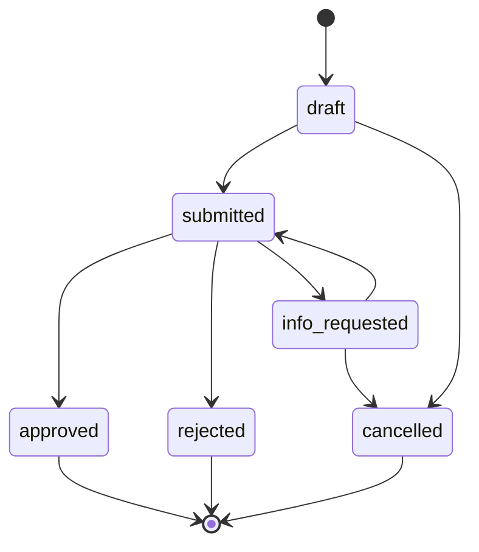

# Cahier des charges V1

> Statut : base de travail à valider avec les acteurs du processus. Un prototype
> existe déjà; ce document doit guider ses évolutions et ne décrit pas encore
> une solution validée pour la production.

## 1. Contexte et objectif

Le projet part d'un parcours observé dans un hôpital au Cameroun : l'agent
recueille les informations du bénéficiaire, prépare une fiche, la transmet à
l'assureur par messagerie, attend sa décision puis récupère un bon imprimé.
Pour une demande d'examen, des pièces médicales signées s'ajoutent au dossier.
L'observation d'un cas réel constitue le point de départ, pas encore une
validation que tous les établissements et assureurs suivent les mêmes règles.

L'objectif final est de concevoir un produit qui facilite et trace les échanges
de prise en charge entre établissements et assureurs, en représentant la
décision et ses montants plutôt que le seul statut « approuvé ». Le prototype
doit permettre d'éprouver ce workflow avec des organisations et des données
fictives, sans dépendre d'une API ou d'un partenariat réel pour être développé.
Un usage réel ne sera envisagé qu'après validation avec les acteurs concernés
et les vérifications techniques, opérationnelles, juridiques et contractuelles
nécessaires. La présentation en portfolio est un résultat professionnel
attendu, mais n'est pas l'objectif métier principal.

## 2. Périmètre

### Dans le périmètre (première version du workflow)
- Portails établissement et assureur simulant des organisations indépendantes
- Workflow de prise en charge pour une consultation
- Workflow simplifié de prise en charge pour un examen
- Calcul de la couverture (voir section 6)
- Bon de prise en charge imprimable ou enregistrable en PDF depuis le navigateur
- Authentification et contrôle d'accès par rôle
- Dépôt sécurisé de documents
- Journal d'audit
- Tests automatisés, déploiement public, comptes de démonstration

### Hors périmètre (pour l'instant)
- Claims et facturation (V2)
- Circuit des médicaments
- Toute intégration avec un vrai assureur, hôpital ou messagerie
- Utilisation de données personnelles ou médicales réelles dans le prototype
- Paiement en ligne
- Correction d'un bon déjà approuvé (nouvelle version du bon, prévue en V2)

## 3. Acteurs et rôles

Trois rôles dans le MVP (détail des droits dans `docs/actors-and-roles.md`) :

| Rôle | Nom dans le code | Organisation |
|---|---|---|
| Agent d'établissement | `facility_agent` | Établissement |
| Gestionnaire assureur | `insurer_manager` | Assureur |
| Administrateur | `platform_admin` | Plateforme |

Règle principale : chaque utilisateur appartient à une seule organisation et
ne voit que les données de son organisation et celles qui lui sont adressées.

## 4. Entités métier

> Les noms en `code` sont ceux du glossaire et deviendront les noms de tables
> et de colonnes. Les montants sont des entiers (FCFA).

### 4.1 Entités

| Entité | Nom dans le code | Rôle | Attributs principaux |
|---|---|---|---|
| Organisation | `organization` | Établissement ou assureur | nom, type (`facility` ou `insurer`) |
| Partenariat établissement-assureur | `facility_insurer` | Autorise un établissement à adresser des demandes à un assureur | établissement, assureur |
| Utilisateur | `user` | Compte de connexion | nom, email, mot de passe haché, rôle, organisation |
| Souscripteur | `subscriber` | Entreprise qui souscrit | nom, assureur |
| Assuré principal | `policyholder` | Salarié titulaire | nom, souscripteur |
| Bénéficiaire | `beneficiary` | Personne qui reçoit les soins | nom, date de naissance, assuré principal, lien de parenté |
| Police | `policy` | Contrat de couverture | numéro, assureur, souscripteur, taux de prise en charge, début, fin |
| Acte médical | `medical_act` | Prestation catalogue | code, libellé |
| Tarif officiel | `official_tariff` | Prix reconnu d'un acte | acte, montant, date d'entrée en vigueur |
| Demande | `authorization_request` | Demande envoyée à l'assureur | établissement, bénéficiaire, police, statut, créée par, demande liée (optionnelle) |
| Ligne de demande | `authorization_item` | Un acte dans la demande | acte, montant facturé, tarif officiel appliqué, montant accepté, part assureur, reste à charge |
| Bon de prise en charge | `authorization` | Décision d'approbation | demande, numéro, valid_from, valid_until, décidé par |
| Document | `document` | Pièce jointe | demande, type, chemin de stockage privé, déposé par |
| Échange de demande | `authorization_request_message` | Historique des questions et réponses entre organisations | demande, auteur, type, message, date |
| Journal d'audit | `audit_log` | Trace des actions sensibles | utilisateur, action, objet concerné, date |

### 4.2 Relations

- Une organisation a plusieurs utilisateurs ; un utilisateur appartient à une seule organisation.
- Un établissement peut travailler avec plusieurs assureurs, et un assureur avec plusieurs établissements; ces partenariats sont configurés par l'administrateur.
- Un assuré principal a plusieurs bénéficiaires.
- Une demande concerne un bénéficiaire, une police et un établissement, et contient une ou plusieurs lignes.
- Une demande approuvée donne un bon.
- Une demande d'examen peut être liée à la demande de consultation dont elle découle.
- Une demande peut avoir plusieurs documents.

### 4.3 Règles de conception

- Chaque ligne de demande **copie** le tarif officiel appliqué au moment de la décision : si la grille change plus tard, les anciens bons ne changent pas.
- Un bon approuvé n'est jamais modifié. La correction par nouvelle version est prévue en V2.
- Les documents sont stockés hors du dossier public, avec un accès contrôlé.
- Les données de démonstration sont entièrement fictives.
- Les gestionnaires d'un assureur maintiennent les souscripteurs, assurés principaux, bénéficiaires et polices de leur propre assureur. L'administrateur plateforme peut intervenir pour une correction exceptionnelle.
- L'alimentation du portefeuille doit permettre un import CSV avec prévisualisation et rapport d'erreurs, ainsi que des corrections manuelles. Le modèle de colonnes sera provisoire tant qu'il n'aura pas été confronté à un format d'assureur anonymisé ou fictif.
- Le modèle CSV provisoire, ses limites et son comportement d'import sont décrits dans `docs/coverage-roster-csv.md`.
- Aucun import ni écran de gestion ne doit être utilisé avec des données personnelles réelles avant les validations de sécurité, confidentialité, conformité et exploitation requises pour un pilote.

### 4.4 Questions ouvertes

- Faut-il séparer le catalogue d'actes de chaque assureur, ou un catalogue commun ?
- Un bénéficiaire peut-il être couvert par plusieurs polices ?
- Le lien de parenté est-il nécessaire pour les règles de calcul, ou seulement informatif ?

## 5. Cycle de vie d'une demande (états et transitions)

### 5.1 États

| État | Nom dans le code | Signification | Final ? |
|---|---|---|---|
| Brouillon | `draft` | En cours de saisie par l'établissement | Non |
| Envoyée | `submitted` | Transmise à l'assureur, en attente de décision | Non |
| Informations demandées | `info_requested` | L'assureur attend des compléments | Non |
| Approuvée | `approved` | Un bon a été généré | Oui |
| Refusée | `rejected` | Refus motivé | Oui |
| Annulée | `cancelled` | Abandonnée par l'établissement | Oui |

### 5.2 Transitions autorisées

| De | Vers | Qui | Conditions | Effets |
|---|---|---|---|---|
| `draft` | `submitted` | `facility_agent` | Au moins une ligne ; bénéficiaire couvert par une police active ; documents obligatoires joints | Écriture dans le journal d'audit |
| `submitted` | `approved` | `insurer_manager` | Demande adressée à son assureur | Génère le bon (numéro, validité, montants calculés) |
| `submitted` | `rejected` | `insurer_manager` | Motif obligatoire | Journal d'audit |
| `submitted` | `info_requested` | `insurer_manager` | Message obligatoire | Journal d'audit |
| `info_requested` | `submitted` | `facility_agent` | Réponse textuelle, nouveau document ou les deux | Réponse horodatée dans l'historique, journal d'audit |
| `draft` | `cancelled` | `facility_agent` | — | Journal d'audit |
| `info_requested` | `cancelled` | `facility_agent` | — | Journal d'audit |

Toute autre transition est **interdite** et doit être refusée par le système.

### 5.3 États du bon

- `active` : la date du jour est comprise dans [valid_from, valid_until].
- `expired` : la date du jour est après `valid_until`.

Ces états sont **calculés** à partir des dates, ils ne sont pas stockés.

### 5.4 Schéma

### 5.5 Questions ouvertes

- Faut-il un état `under_review` pour savoir qu'un gestionnaire a ouvert la demande ?
- Une demande envoyée peut-elle être annulée par l'établissement avant la décision ?
- Une demande refusée peut-elle être rouverte, ou faut-il en créer une nouvelle ?

## 6. Règles de calcul de la couverture

### 6.1 Définitions
- **Montant facturé** (`billed_amount`) : prix demandé par l'établissement pour un acte médical.
- **Tarif officiel** (`official_tariff`) : prix officiellement reconnu pour cet acte (tarif de l'État).
- **Taux de prise en charge** (`coverage_rate`) : pourcentage du montant accepté payé par l'assureur (0 à 100).
- **Montant accepté** (`accepted_amount`) : partie du montant facturé que l'assureur reconnaît.
- **Dépassement** (`overrun`) : partie du montant facturé au-dessus du tarif officiel.

### 6.2 Règles (calculées par acte, jamais sur le total)
1. Le montant reconnu pour le calcul est le plus petit entre le montant
   facturé par l'établissement et le tarif de référence :
   `accepted_amount = min(billed_amount, official_tariff)`.
2. La part assureur est le taux de la police appliqué à ce montant reconnu :
   `insurer_share = arrondi(accepted_amount x coverage_rate / 100)`, à l'entier
   le plus proche.
3. Le patient paie la différence entre le montant facturé et la part assureur :
   `patient_share = billed_amount - insurer_share`.
4. Le dépassement est la partie facturée au-dessus du tarif de référence :
   `overrun = max(0, billed_amount - official_tariff)`.
5. Les totaux du bon sont la somme des valeurs calculées par acte.

Ainsi, si l'établissement facture moins que le tarif, la part assureur est
calculée sur le prix effectivement demandé, jamais sur un tarif supérieur. Si
le prix facturé dépasse le tarif, la part assureur est plafonnée au taux de
couverture appliqué au tarif; le dépassement reste à la charge du patient.
Cette règle est le comportement retenu par le produit; elle devra être
confirmée avec chaque assureur et contrat avant un pilote réel.

Le dépassement (`overrun`) est une information affichée sur le bon : il est
déjà inclus dans `patient_share`, il ne doit pas être ajouté une seconde fois.

### 6.3 Invariants
- Tous les montants sont des entiers positifs ou nuls (le FCFA n'a pas de décimales).
- insurer_share + patient_share = billed_amount, toujours.
- 0 <= insurer_share <= accepted_amount <= billed_amount.
- Seuls les actes explicitement listés sur le bon sont couverts.
- Un bon n'est utilisable que dans [valid_from, valid_until]. La plateforme affiche ce statut ; elle ne contrôle pas la date de la prestation (hors MVP).
- La validité par défaut est de 7 jours ; elle est stockée dans chaque bon, pas écrite en dur dans le code.

### 6.4 Cas de référence (valeurs fictives)
| Cas | Facturé | Tarif officiel | Taux | Part assureur | Reste à charge |
|---|---|---|---|---|---|
| A. Établissement moins cher que le tarif | 8000 | 10000 | 100% | 8000 | 0 |
| B. Prix égal au tarif | 10000 | 10000 | 100% | 10000 | 0 |
| C. Dépassement | 12000 | 10000 | 100% | 10000 | 2000 |
| D. 80 %, sans dépassement | 10000 | 10000 | 80% | 8000 | 2000 |
| E. 80 %, avec dépassement | 12000 | 10000 | 80% | 8000 | 4000 |
| F. 80 %, établissement moins cher que le tarif | 8000 | 10000 | 80% | 6400 | 1600 |

### 6.5 Questions ouvertes
- La règle produit du cas A/F est que le taux s'applique au prix facturé si celui-ci est inférieur au tarif; confirmer cette règle avec chaque assureur avant un pilote réel.
- Le taux de prise en charge est-il toujours de 100 % ? (cas D, E)
- Règle d'arrondi quand taux x montant accepté n'est pas un entier (proposition : arrondi à l'entier le plus proche, calculé en entiers pour éviter les erreurs de décimales).
- Source et mise à jour du tarif officiel (grille de l'État, coefficient de l'acte x valeur unitaire ?).
- La franchise d'hospitalisation est exprimée en jours : hors MVP pour l'instant.
- Médicaments : hors MVP.

## 7. Workflows principaux

### 7.1 Workflow 1 : consultation

1. `facility_agent` choisit un assureur parmi les partenaires de son établissement, à partir des justificatifs du patient.
2. Il recherche le bénéficiaire par son nom ou son numéro de carte/membre; les résultats sont limités aux personnes ayant une police active auprès de l'assureur choisi.
3. Il vérifie le bénéficiaire et choisit explicitement la police applicable. Si plusieurs polices sont actives, elles sont affichées séparément avec leur numéro et leur taux; le système ne choisit pas silencieusement la plus récente.
4. Le serveur revérifie le partenariat établissement-assureur, le lien bénéficiaire-police, l'assureur de cette police et ses dates d'activité avant d'accepter la sélection.
5. `facility_agent` crée une demande et ajoute les actes (code, montant facturé).
6. Le système calcule pour chaque ligne le tarif officiel, le montant accepté, la part assureur et le reste à charge (section 6), selon le taux enregistré sur la police sélectionnée.
7. `facility_agent` joint les documents requis puis envoie la demande (`draft` → `submitted`).
8. `insurer_manager` examine la demande et la fait passer à `approved`, `rejected` ou `info_requested`.
9. Si `approved`, le système génère le bon avec son numéro, sa validité (7 jours par défaut), la liste des actes autorisés, la part assureur et le reste à charge.
10. `facility_agent` consulte le bon et l'imprime ou l'enregistre en PDF depuis
   son navigateur.

### 7.2 Workflow 2 : examen prescrit

1. Une consultation a eu lieu (workflow 1 déjà approuvé).
2. Le médecin prescrit un examen sur la fiche maladie, signée et cachetée (document papier, hors plateforme).
3. `facility_agent` choisit l'assureur et le même bénéficiaire couvert, crée une **nouvelle demande liée** à la demande de consultation et y joint la fiche maladie numérisée.
4. Les étapes 4 à 10 du workflow 1 s'appliquent ensuite.

### 7.3 Cas alternatifs

| Situation | Comportement attendu |
|---|---|
| Bénéficiaire sans police active | L'envoi est refusé avec un message clair |
| Document obligatoire manquant | L'envoi est refusé et la liste des pièces manquantes est affichée |
| Informations demandées | La demande revient à l'établissement avec le message de l'assureur |
| Refus | Le motif est visible par l'établissement |
| Bon expiré | Affiché comme expiré ; un nouveau bon exige une nouvelle demande |
| Prix facturé supérieur au tarif officiel | Le dépassement est calculé et indiqué sur le bon |

### 7.4 Hors MVP

Paiement du reste à charge à la caisse, médicaments, claims et facturation.

## 8. Exigences non fonctionnelles

### 8.1 Sécurité

| Exigence | Vérification |
|---|---|
| Mots de passe stockés hachés avec le mécanisme du framework | Revue de code, jamais de mot de passe en clair en base |
| Limitation du nombre de tentatives de connexion | Test automatisé |
| Un utilisateur ne voit jamais les données d'une autre organisation | Test d'isolation entre organisations |
| Toute entrée est validée côté serveur | Tests de validation sur chaque formulaire |
| Requêtes paramétrées, protection CSRF et XSS fournies par le framework | Revue de code, pas de contournement |
| Aucun secret dans le dépôt ; `.env` ignoré, `.env.example` fourni | Contrôle avant chaque commit |
| Messages d'erreur sans détails techniques pour l'utilisateur | Test en mode production |

### 8.2 Documents

- Types acceptés : PDF, JPEG, PNG uniquement.
- Taille maximale : 5 Mo par fichier (valeur de départ).
- Stockage hors du dossier public, nom de fichier généré aléatoirement.
- Téléchargement uniquement par un utilisateur autorisé sur la demande concernée.

### 8.3 Audit

Sont écrits dans le journal d'audit : connexion et échec de connexion, création, envoi et décision d'une demande, réponse à une demande d'informations, génération et téléchargement d'un bon, changement de rôle. Chaque entrée contient l'utilisateur, l'action, l'objet, la date. Aucune donnée médicale détaillée ni le contenu des messages dans les journaux.

Les demandes d'informations et les réponses textuelles sont conservées dans
l'historique de la demande et visibles aux deux organisations concernées. Pour
répondre, l'établissement peut envoyer un texte, joindre un nouveau document
ou faire les deux. Un simple renvoi sans complément est refusé.

### 8.4 Données et confidentialité

- Données de démonstration **entièrement fictives**, aucune donnée réelle dans le dépôt, la base de démo ou la vidéo.
- Collecte minimale : seulement les champs nécessaires aux règles de la section 6.

### 8.5 Qualité et utilisabilité

- Listes paginées (20 éléments par page au départ).
- Index en base justifiés par les requêtes réelles.
- États de chargement, de liste vide et d'erreur sur chaque écran.
- Affichage utilisable sur mobile et sur ordinateur.
- Formulaires accessibles : étiquettes, messages d'erreur lisibles, navigation au clavier.

### 8.6 Ingénierie

- Linter, formateur et analyse statique sans erreur.
- Intégration continue verte avant chaque fusion.
- Migrations de base de données réversibles.
- Messages de commit au format Conventional Commits.

## 9. Critères de réussite de la première version démontrable

Le projet est terminé quand tous les critères ci-dessous sont remplis.

| # | Critère | Comment le vérifier |
|---|---|---|
| 1 | Les 5 cas de référence de la section 6.4 passent en test automatisé | Commande de test |
| 2 | Le workflow consultation fonctionne de bout en bout | Parcours manuel + test d'intégration |
| 3 | Le workflow examen fonctionne avec une demande liée | Parcours manuel |
| 4 | Un `facility_agent` ne peut pas approuver ; un `insurer_manager` ne peut pas créer | Tests d'autorisation |
| 5 | Une organisation ne voit jamais les données d'une autre | Test d'isolation |
| 6 | Le bon est imprimable ou enregistrable en PDF depuis le navigateur, avec les montants corrects | Comparaison avec les cas de référence et impression navigateur |
| 7 | Documents : upload limité aux types et tailles autorisés, téléchargement contrôlé | Tests |
| 8 | Le journal d'audit enregistre les actions listées en 8.3 | Consultation par `platform_admin` |
| 9 | L'intégration continue est verte | Badge dans le README |
| 10 | Application déployée avec des comptes de démonstration | URL publique |
| 11 | README et `docs/` à jour, avec au moins trois décisions d'architecture documentées | Relecture |
| 12 | Vidéo de démonstration de 3 à 5 minutes | Fichier ou lien |

Hors critères pour la V1 : claims, facturation, médicaments et intégration à un
système réel d'assureur. Ces éléments ne sont pas nécessaires pour démontrer
le workflow principal avec des données fictives.

La réussite de cette version ne signifie pas que le produit est prêt à traiter
des données réelles. Un pilote opérationnel demandera en plus :

- validation du workflow et des règles par les établissements et assureurs
  concernés;
- revue de sécurité et vérification des permissions et de l'isolation des
  organisations;
- choix et essais de l'hébergement, du stockage privé, des sauvegardes et de la
  restauration;
- clarification des obligations applicables, des responsabilités et accords
  avec des personnes compétentes;
- procédures de conservation, export, suppression et réponse aux incidents.

## 10. Questions ouvertes

Légende : **Terrain** = à demander à une personne qui connaît le processus ;
**Décision** = je tranche moi-même ; **Recherche** = à chercher dans une source officielle.

| # | Question | Origine | Type | À résoudre avant |
|---|---|---|---|---|
| 1 | Quand le prix de l'établissement est inférieur au tarif, l'assureur paie-t-il le prix facturé ? | 6.5 | Terrain | Phase 1 |
| 2 | Le taux de prise en charge est-il toujours de 100 % ? | 6.5 | Terrain | Phase 1 |
| 3 | Règle d'arrondi quand le taux donne un montant non entier | 6.5 | Décision | Phase 1 |
| 4 | Source et mise à jour du tarif officiel (coefficient × valeur unitaire ?) | 6.5 | Recherche | Phase 1 |
| 5 | Rôle exact du médecin-conseil | Glossaire, 3 | Terrain | Phase 2 |
| 6 | Un état `under_review` est-il utile ? | 5.5 | Décision | Phase 2 |
| 7 | Annulation possible d'une demande envoyée ? | 5.5 | Décision | Phase 2 |
| 8 | Demande refusée : rouvrir ou en recréer une ? | 5.5 | Terrain | Phase 2 |
| 9 | Catalogue d'actes commun ou propre à chaque assureur ? | 4.4 | Décision | Phase 1 |
| 10 | Un bénéficiaire peut-il avoir plusieurs polices ? | 4.4 | Terrain | Phase 2 |
| 11 | Qui gère polices et tarifs : administrateur plateforme ou assureur ? | Rôles | Décision | Phase 2 |
| 12 | Cadre légal camerounais sur les données de santé et personnelles | 8.4 | Recherche | Avant mise en ligne |
| 13 | Circuit des médicaments côté pharmacie | Document de départ | Terrain | Hors MVP |
| 14 | Hébergeur de démonstration et base de données (ADR 0002) | ADR 0001 | Décision | Avant le déploiement public |